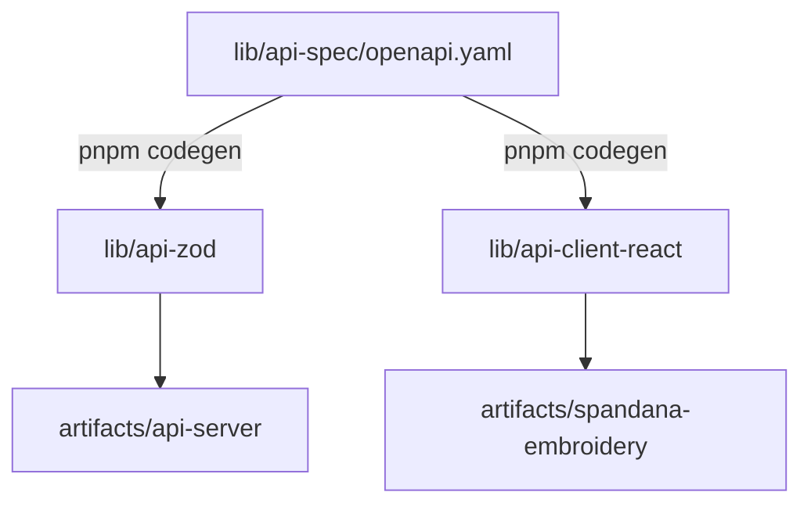

# CLIXAD — Developer & Workspace Guidance

[](https://pnpm.io/)
[](https://www.typescriptlang.org/)
[](LICENSE)

This document provides operational context, architecture overviews, and developer conventions for engineering work across the **Spandana Embroidery** monorepo.

---

## 🏛 Monorepo Architecture Overview

The repository is organized as a **pnpm multi-package workspace**:

```
embroidery-website/
├── artifacts/
│   ├── spandana-embroidery/     # React 19 / Vite frontend customer site
│   ├── api-server/              # Express API server with Gemini proxy
│   └── mockup-sandbox/          # UI component sandbox (archived)
├── lib/
│   ├── api-spec/                # Source of truth: OpenAPI 3.1 specification
│   ├── api-zod/                 # Generated Zod schemas
│   ├── api-client-react/        # Generated React Query / Orval client hooks
│   └── db/                      # Drizzle ORM schema & database tools
├── pnpm-workspace.yaml          # Monorepo catalog and workspace definitions
└── package.json                 # Monorepo task runner
```

All internal dependencies are resolved via workspace protocol:
- `@workspace/spandana-embroidery`
- `@workspace/api-server`
- `@workspace/api-spec`
- `@workspace/api-zod`
- `@workspace/api-client-react`
- `@workspace/db`

---

## ⚡ Essential Commands Cheat Sheet

Always execute these commands from the **workspace root**:

| Action | Command | Purpose |
| :--- | :--- | :--- |
| **Install Dependencies** | `pnpm install` | Installs all packages across workspaces |
| **Typecheck Everything** | `pnpm run typecheck` | Validates TypeScript across all workspaces |
| **Typecheck Libraries** | `pnpm run typecheck:libs` | Validates `lib/*` packages via project references |
| **Build Everything** | `pnpm run build` | Full workspace production build |
| **Run Frontend Dev** | `pnpm -F @workspace/spandana-embroidery dev` | Starts Vite dev server (port 18274 or `$PORT`) |
| **Run API Server Dev** | `pnpm -F @workspace/api-server dev` | Builds & starts Express backend (port 5000) |
| **Regenerate API Clients**| `pnpm -F @workspace/api-spec codegen` | Generates Zod and React hooks from OpenAPI |
| **Code Formatting** | `pnpm exec prettier --write .` | Formats all workspace files |

---

## 📌 Core Conventions & Rules

### 1. Package Manager Strictness
> [!IMPORTANT]
> **Use pnpm only.** The root `package.json` enforces this via a `preinstall` hook. Running `npm` or `yarn` will intentionally exit with an error.

### 2. Supply Chain Security Guard
Do not disable or lower `minimumReleaseAge` in `pnpm-workspace.yaml` (set to 1440 minutes / 24 hours). This prevents automated installation of newly published, potentially compromised packages.

### 3. Contract-First API Development

- **Never edit generated files directly** under `lib/api-zod/src/generated/` or `lib/api-client-react/src/generated/`.
- Always edit `lib/api-spec/openapi.yaml` first, then run `pnpm -F @workspace/api-spec codegen`.

### 4. API Key & Secret Hygiene
> [!WARNING]
> Never expose or bundle `GEMINI_API_KEY` into frontend client code, Vite defines, or URL queries. AI endpoints must route exclusively through the server-side proxy in `artifacts/api-server`.

### 5. Single Source of Truth for Data
All portfolio designs, pricing estimates, FAQ accordions, and studio contact data live centrally in `artifacts/spandana-embroidery/src/data/`:
- `business.ts` — Atelier hours, phone, email, and location.
- `designs.ts` — Design portfolio items and metadata.
- `pricing.ts` — Sample cost ranges and estimate rules.
- `faqs.tsx` — Frequently asked customer questions.

### 6. Interactive Demo Disclosures
All forms (custom brief, contact inquiry, membership registration) are **presentation-first demo flows**:
- They provide immediate accessible client-side confirmation feedback.
- They do **not** collect passwords or transmit unencrypted sensitive personal details.
- The Quote Basket is a **planning shortlist**, not an e-commerce checkout.

### 7. Accessibility Standard
Ensure all changes respect:
- Visible focus rings (`:focus-visible`).
- Accessible semantic headings (`h1` through `h4`).
- Screen reader announcements (`aria-live`, `aria-expanded`).
- Complete fallback when `prefers-reduced-motion` is active.
